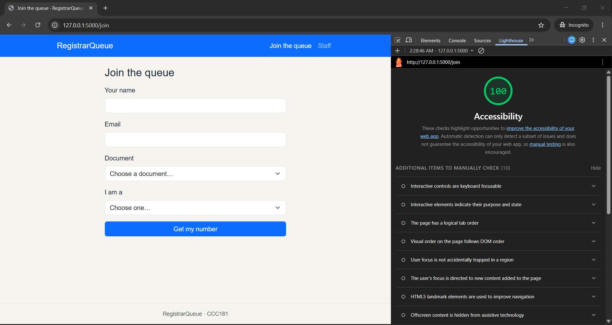
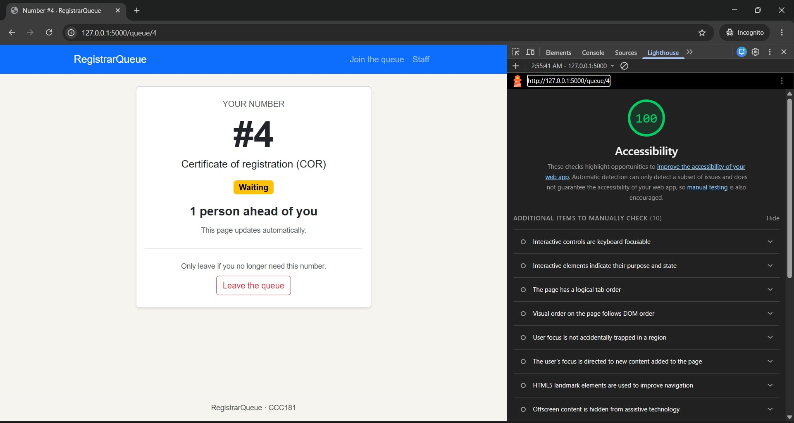
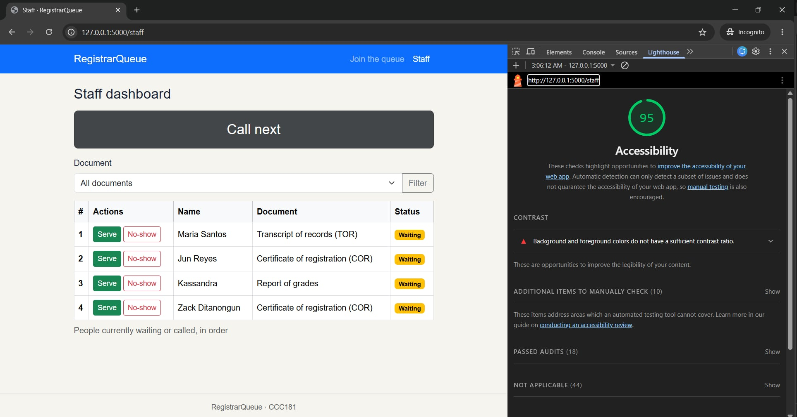

# Accessibility check

## Lighthouse (Accessibility, mobile)

| Screen | Score before | Score after | Screenshot |
| --- | --- | --- | --- |
| Join | | |  |
| My place | | |  |
| Staff | | |  |

There are no screenshots with below 90 score. No issues found.

## Keyboard test

- I can see the focus at every step and I can reach every control.
- Skip link appears on the first Tab: yes 

## Manual checklist

| Check | Join | My place | Staff |
| --- | --- | --- | --- |
| Every input has a visible label |✓|✓|✓|
| Error messages say what to do, in text |✓|✓|✓|
| Status is shown in words, not only color |✓|✓|✓|
| Readable at 375 px with no sideways page scroll |✓ |✓ |✓ |
| Buttons at least about 44 × 44 px on a phone |✓|✓|✖ → fixed: Serve and No-show used btn-sm (about 31 px tall); replaced with a .action-btn rule with min-height: 44px and wider spacing.|
| One `<h1>` and headings in order |✓|✓|✓|
| `<html lang>` is set |✓|✓|✓|