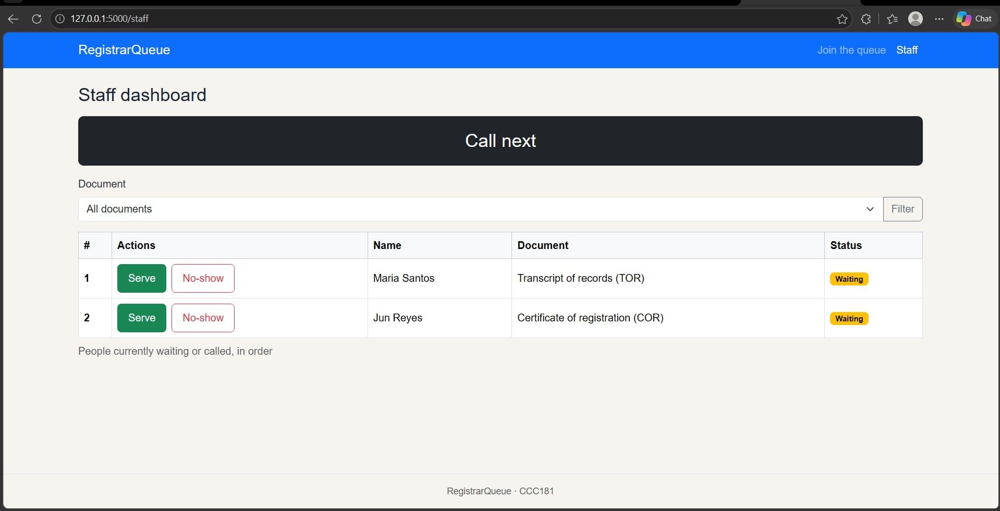
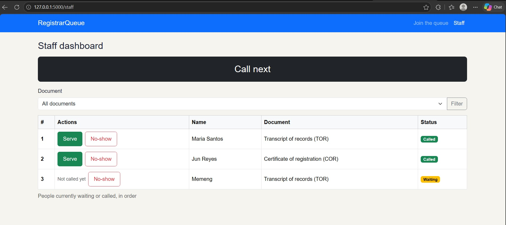

# Usability test

**Participant:** 3rd-year student who has claimed documents at the MSU-IIT Registrar before
**Device:** Tasks 1 and 2 on a phone (375 px wide), Task 3 on a laptop

| Task | Finished? | Time | Notes (hesitations, quotes, surprises) |
| --- | --- | --- | --- |
| 1. Join the queue for Transcript of records (TOR) | Yes, without help | about 50 seconds | Found the Join button on the home page right away. Paused for about 10 seconds at the "I am a" field. Said: "Why do they ask if I'm a student or alumni?" Then asked: "Do I pay first before I get a number, or after?" |
| 2. Find the number and people ahead | Yes, without help | about 5 seconds | Read "#14" and "3 people ahead of you" immediately. Said: "Ah, it's big, I don't need to look for it." Read the "Waiting" badge as well. |
| 3. As staff, call the next person and mark them served | Yes, without help | about 1 minute | Found "Call next" at once: "That's the big one." After that, hesitated for about 15 seconds because two rows (one Called, one Waiting) both had a Serve button. Said: "They all have Serve, so which one am I supposed to press?" Then pressed Serve on the green Called row. |

Surprise: the participant noticed that Serve could be pressed on a ticket that had not been called, and said "so I could serve someone who didn't even come to the counter".

## Which persona rules held up

- **Dani, rule 1 (ticket number and position are the biggest thing):** held. The number and position were found in about 5 seconds on the phone.
- **Dani, rule 2 (status in words, updates by itself):** held for the words ("Waiting" was read correctly). The automatic update was not tested in this session.
- **Dani, rule 3 (short Join form):** mostly held. The form was finished quickly, but the extra "I am a" field caused a short pause because its purpose is not explained.
- **Dani, rule 4 (she knows what to do and bring):** did not fully hold. The participant did not know whether to pay before or after getting a number, which the Join page does not say.
- **Mr. Reyes, rule 1 (Call next is the biggest and easiest button):** held. It was found immediately.
- **Mr. Reyes, rule 2 (document type on every row):** held. The participant used the Document column to confirm the right row.
- **Mr. Reyes, rule 3 (No-show one click away, status in words):** held. The status badges were read correctly.
- **Mr. Reyes, rule 4 (buttons can't hit the wrong person):** did not hold. Identical Serve buttons appear on rows that have not been called.

## Most serious problem

On the staff dashboard, every row has a Serve button, even for tickets that have not been called yet. The participant hesitated over which Serve to press, and noticed that staff could serve a person who never came to the counter. This is a risk to fairness and breaks Mr. Reyes's rule 4. It is linked to the usability principle of **error prevention**.

Other problems found (not fixed this week): the Join page does not explain when to pay and bring the receipt, and the purpose of the "I am a" field is not explained.

## The fix

- **Problem:** Serve is available on tickets that are still Waiting, so staff can serve the wrong person by mistake.
- **What I changed:** The Serve button now appears only on tickets with the status Called. Waiting rows show "Not called yet" instead, and the server also rejects a Serve request for a ticket that has not been called, so the rule can't be bypassed.
- **Before:** 
- **After:** 
